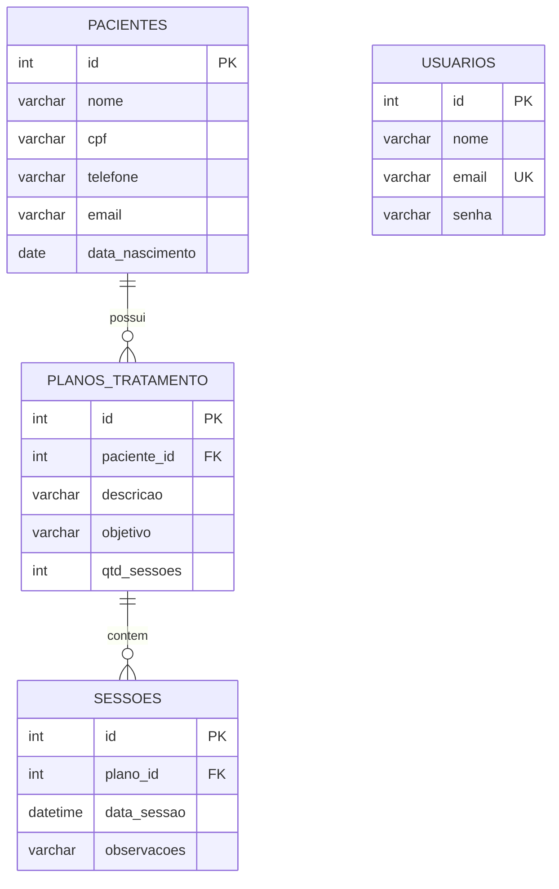

# Documentação Técnica — Sistema de Gestão para Clínica de Fisioterapia

## 1. Contextualização e Objetivo

Este sistema foi desenvolvido para informatizar a rotina de atendimentos de uma clínica de fisioterapia, substituindo o controle manual de pacientes, planos de tratamento e agendamentos de sessões. A solução garante integridade referencial em banco de dados relacional, autenticação com expiração de sessão e proteção de dados pessoais (CPF) em conformidade com a Lei Geral de Proteção de Dados (LGPD).

---

## 2. Tecnologias Utilizadas

- **Backend:** Node.js, Express 5
- **Templates:** Mustache
- **Banco de Dados:** MySQL (`mysql2/promise`)
- **Autenticação e Segurança:**
  - `bcryptjs` para hash de senhas
  - `jsonwebtoken` (JWT) com expiração de `1h` armazenado em cookie `httpOnly`
  - `crypto` (`AES-256-CBC`) para criptografia de CPF

---

## 3. Requisitos Funcionais (RF)

| Código | Requisito | Descrição |
| :--- | :--- | :--- |
| **RF01** | Autenticação de Usuários | O sistema deve permitir o login por e-mail e senha, validando credenciais e exibindo mensagem de erro em caso de falha. |
| **RF02** | Tela Principal | Após o login, deve exibir o nome do usuário logado, links para os módulos (Pacientes, Planos de Tratamento, Sessões) e opção de sair (`/sair`). |
| **RF03** | Gerenciamento de Pacientes | Deve permitir cadastrar, listar, buscar por nome, editar e excluir pacientes, armazenando o CPF criptografado no banco. |
| **RF04** | Gerenciamento de Planos de Tratamento | Deve permitir cadastrar, listar, editar e excluir planos de tratamento, associando obrigatoriamente cada plano a um paciente. |
| **RF05** | Agendamento de Sessões | Deve listar as sessões ordenadas por data (`data_sessao ASC`) exibindo todos os dados do paciente e do plano de tratamento, além de permitir cadastrar, atualizar a data da sessão e excluir. |

---

## 4. Requisitos Não Funcionais (RNF)

- **RNF01 — Segurança de Senhas:** As senhas dos usuários devem ser armazenadas com hash `bcrypt`.
- **RNF02 — Proteção de Dados (LGPD):** O CPF dos pacientes deve ser armazenado criptografado (`AES-256-CBC`) no banco de dados e descriptografado apenas na exibição autenticada.
- **RNF03 — Expiração de Sessão:** O token JWT deve expirar após 1 hora (`expiresIn: "1h"`), exigindo nova autenticação após o vencimento.
- **RNF04 — Integridade Referencial:** O banco de dados `fisio_db` deve impedir exclusão de registros que possuam dependências via chaves estrangeiras.

---

## 5. Regras de Negócio

1. **RN01:** O script `fisio_db.sql` deve conter ao menos 3 registros em cada tabela criada.
2. **RN02:** Em caso de falha no login, o sistema deve validar e informar o usuário sem conceder acesso.
3. **RN03:** O CPF do paciente deve ser criptografado antes da persistência no banco de dados.
4. **RN04:** A tela principal deve exibir o nome do usuário logado, acesso aos módulos e botão para sair.
5. **RN05:** A tela de pacientes deve possuir busca por termo (nome) e edição com persistência no banco.
6. **RN06:** A tela de sessões deve ordenar os registros por dia/horário da sessão, exibindo todos os dados do paciente e do plano, permitindo atualizar a data da sessão.
7. **RN07:** Ao cadastrar ou editar um plano de tratamento, é obrigatório associá-lo a um paciente.

---

## 6. Rotas da Aplicação

| Método | Rota | Descrição |
| :--- | :--- | :--- |
| `GET` | `/` | Exibe a tela de login |
| `POST` | `/login` | Autentica usuário e gera cookie JWT (`1h`) |
| `POST` | `/sair` | Remove o cookie de sessão e redireciona para `/` |
| `GET` | `/principal` | Exibe a tela principal com o nome do usuário |
| `GET` | `/pacientes` | Lista pacientes (com filtro `?busca=` e edição `?editar=`) |
| `POST` | `/pacientes` | Cadastra novo paciente com CPF criptografado |
| `PUT` | `/pacientes/:id` | Atualiza dados do paciente |
| `DELETE` | `/pacientes/:id` | Exclui paciente (se não possuir planos) |
| `GET` | `/planos` | Lista planos de tratamento e pacientes |
| `POST` | `/planos` | Cadastra plano associado a um paciente |
| `PUT` | `/planos/:id` | Atualiza plano de tratamento |
| `DELETE` | `/planos/:id` | Exclui plano (se não possuir sessões) |
| `GET` | `/sessoes` | Lista sessões ordenadas por `data_sessao` com dados completos |
| `POST` | `/sessoes` | Agenda nova sessão |
| `PUT` | `/sessoes/:id` | Atualiza a data/hora da sessão |
| `DELETE` | `/sessoes/:id` | Exclui sessão |

---

## 7. Diagrama Entidade-Relacionamento (DER)

---

## 8. Execução Local

1. Copie `.env.example` para `.env` e configure `DB_HOST`, `DB_USER`, `DB_PASSWORD` e `DB_NAME=fisio_db`.
2. Importe e execute o script `database/fisio_db.sql` no MySQL.
3. Instale as dependências (`npm install`) e inicie com `npm start`.
4. Acesse `http://localhost:3000`. Usuário padrão: `admin@fisio.com` / Senha: `123456`.
